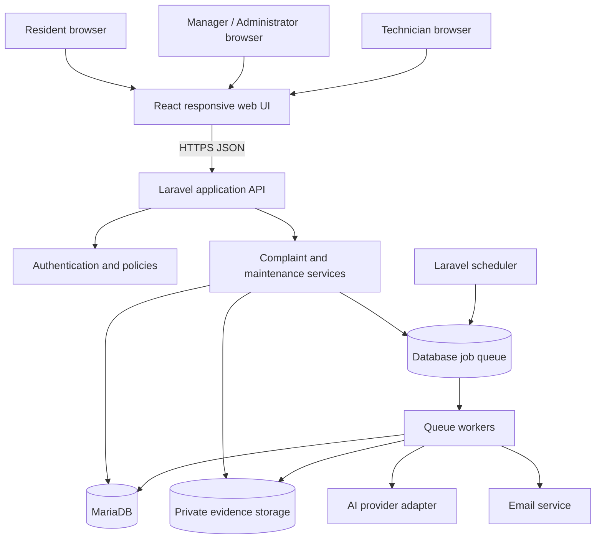
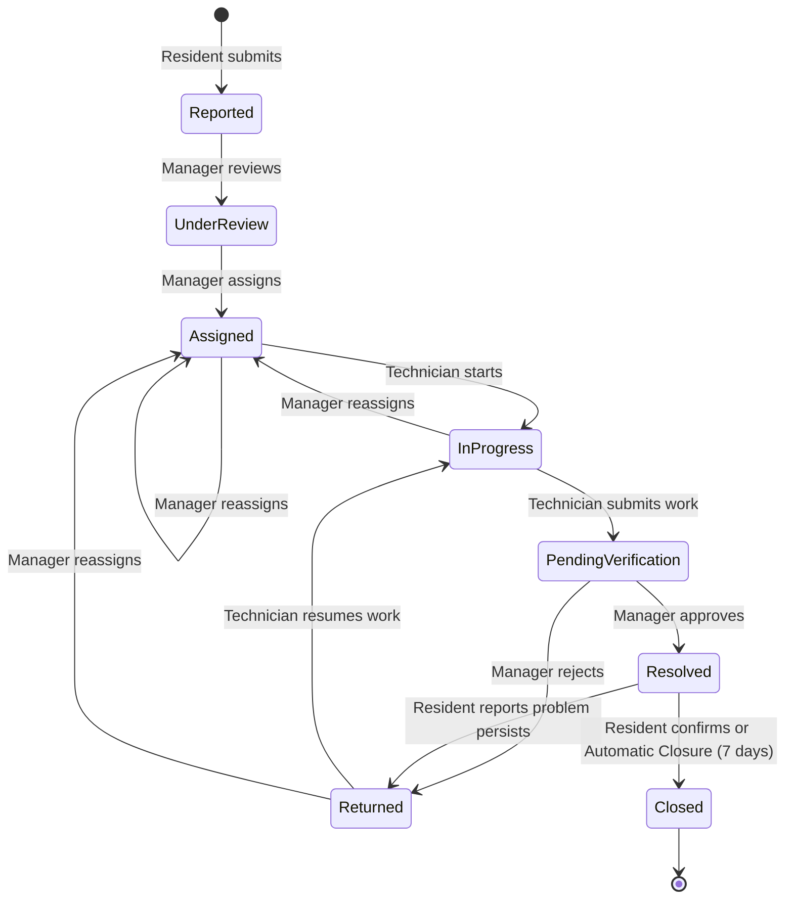
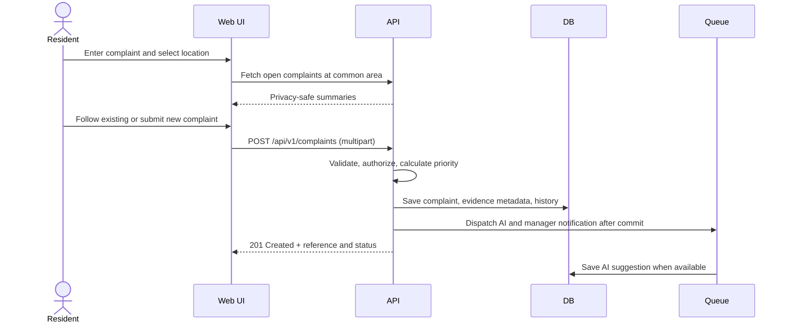
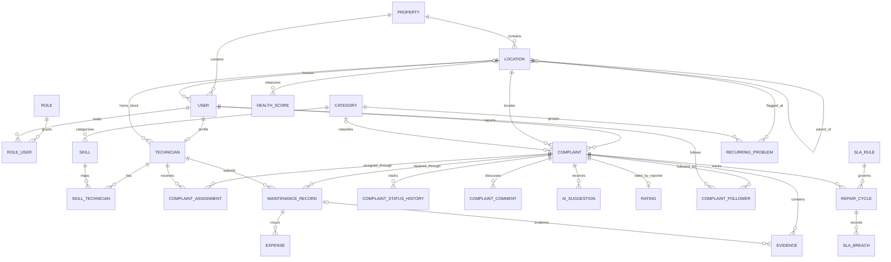

# Web Application Design Document

## Web-Based Apartment Maintenance and Complaint Management System

| Document information | Details |
|---|---|
| Course | ITT626: Back-End Technology |
| Semester | March – August 2026 |
| Prepared by | Amsyar Daniel Bin Amran (2024282844) |
| Prepared for | Dr. Muhammad Azizi Bin Mohd Ariffin |
| Version | 1.1 – agreed implementation design |
| Source | `Cover_page_case_study_ITT626.pdf` (31 pages) |

> **Design basis:** The functional requirements, roles, workflow, SLA targets, recurring-problem threshold and screen inventory are drawn from the supplied case study. Architecture, technology choices, API contracts, schema extensions, scoring rules and operational controls are implementation decisions made for this project where the case study is silent; they were agreed in a design review on 25 November 2026. Decisions that are hard to reverse are recorded as ADRs in `docs/adr/`, and domain terms are defined in `GLOSSARY.md`. Section 15 lists the decision log and the few items still deferred.

## 1. Project overview

### 1.1 Background and problem statement

Apartment maintenance complaints are currently communicated through WhatsApp, phone calls and office walk-ins. Although familiar to residents, these channels create fragmented records, duplicate reports, limited status visibility, inconsistent prioritization and inefficient technician assignment. Management also lacks consolidated maintenance history for detecting repeated failures and measuring service performance.

The application provides a centralized, mobile-first complaint portal and management workspace. It supports reporting, prioritization, assignment, repair, verification, resident confirmation and historical analytics.

### 1.2 Objectives

1. Enable residents to submit maintenance complaints and track progress online.
2. Help managers prioritize complaints and assign suitable technicians or contractors.
3. Provide maintenance performance dashboards and reports for the building manager and Joint Management Body (JMB) committee.

### 1.3 Scope

**In scope:** One residential apartment development managed by one office; common building systems under management responsibility; complaints against Units and Common Areas; web access for residents, managers, technicians and administrators; evidence, notifications, SLA monitoring, Recurring Problems, Health Scores and Management Reports.

**Out of scope:** Multi-property SaaS, native mobile apps, payment collection, tenancy management, private repairs outside management responsibility, IoT integrations and automatic WhatsApp ingestion. Existing reporting channels may continue operationally, but integration is not specified by the source.

**Delivery scope for ITT626:** Roadmap Phases 1–4 (foundation, resident reporting, maintenance workflow, monitoring) are built. Phase 5 (exports and AI) is a stretch goal. Phase 6 (release) is covered by documentation only; the system is demonstrated locally rather than deployed.

### 1.4 Location model

The managed development is one **Property**, the root of a Location tree: **Property → Block → Floor → Unit**. A **Common Area** (for example a pool, lift or corridor) can be attached to the Property, a Block or a Floor. A Common Area attached directly to the Property is a **Shared Area**, scored as its own group. Complaints are raised only against Units and Common Areas, never against a Block or Floor itself; for example, "Lift B1 not operating" is raised against the Common Area *Lift B1* under *Block B*.

## 2. Users and authorization

| Capability | Resident | Manager | Technician | Administrator |
|---|---|---|---|---|
| Sign in, reset password, notifications | Yes | Yes | Yes | Yes |
| Submit complaint | Yes | — | — | — |
| View own complaint and timeline | Yes | All | Assigned only | Administrative access |
| View open common-area complaint summaries | Yes | Yes | Assigned only | Yes |
| Follow an existing common-area complaint | Yes | — | — | — |
| Confirm repair, return complaint, rate repair | Own complaint | — | — | — |
| Review, classify, set priority, assign/reassign | — | Yes | — | — |
| Start work, upload evidence, submit maintenance record | — | — | Assigned only | — |
| Verify repair or return with reason | — | Yes | — | — |
| Manage technician profiles | — | Yes | — | Yes |
| Dashboard and analytics | Personal | Operational | Personal tasks | Administrative |
| Recurring flags, health scores and reports | — | Yes | — | Administrative access |
| Manage users, roles, locations, categories, skills, SLA | — | — | — | Yes |
| View audit logs | — | — | — | Yes |

The administrator landing page may reuse the manager dashboard as shown in the sign-in flow (p. 12), but administrative access does not confer manager workflow permissions. Each account holds exactly one role; a person who is both Manager and Administrator uses two accounts. JMB is a report audience, not a separate login role. There is no public registration: the Administrator creates accounts at the management counter, linking each Resident to one Unit and a **Resident Type** (Owner, Tenant or Student; descriptive only, usable as a report filter, with no workflow effect). The new account holder receives an emailed set-password link, valid once for 72 hours. Contractors are Technicians with type Contractor and a company name; they have accounts and use the same task screens as in-house staff. Deactivated accounts cannot sign in or continue existing sessions.

## 3. Functional requirements

| ID | Module | Required behavior |
|---|---|---|
| FR-01 | Authentication and authorization | Sign in, reset password, enforce roles, block inactive accounts. |
| FR-02 | Resident and user management | Create, update, activate/deactivate accounts; link residents to units and resident types. |
| FR-03 | Location management | Maintain hierarchical blocks, floors, units and common areas with importance levels. |
| FR-04 | Complaint reporting | Capture title, description, location, category, urgency, safety risk, affected units/people, essential-service impact and up to five photos; show existing open reports at common areas. |
| FR-05 | Complaint classification | Maintain the ten categories and default priorities in Section 6.1; support system category suggestions. The report names Lift, Plumbing & Water Supply and Fire & Safety as examples. |
| FR-06 | Priority management | Explain rule-based priority; display AI suggestion separately; manager confirms or overrides. |
| FR-07 | Technician/contractor management | Maintain type, company, skills, availability, maximum tasks and home block. |
| FR-08 | Assignment management | Rank suitable technicians; allow manager assignment/reassignment with workload warning. |
| FR-09 | Maintenance workflow | Enforce valid status transitions and retain change history. |
| FR-10 | Evidence/file management | Resize and re-encode report and repair photos; use random storage names. |
| FR-11 | SLA monitoring | Track response and resolution deadlines, configurable by priority; record breaches and notify once per breach. |
| FR-12 | Notification management | In-app notifications for every relevant event; email only for new complaints, assignments, Resolved and SLA breaches (Section 11). |
| FR-13 | Recurring problem detection | Detect repeated location/category complaints; manager acknowledges or dismisses flags. |
| FR-14 | Dashboards and analytics | Role-specific summaries, charts, action lists and block/shared-area health scores. |
| FR-15 | Reports | Monthly/custom filtered PDF and Excel reports, AI management summary and AI accuracy report. |
| FR-16 | Audit log | Record sign-ins and changes to complaints, accounts and settings. |

Source: pp. 8–11, 18–29.

## 4. Technical architecture

### 4.1 Technology stack

The case study does not prescribe the stack. The system is a modular monolith sized for the single-apartment scope: a Laravel JSON REST API consumed by a separate React SPA on the same origin (ADR 0001). Laravel and React are consistent with the skills described in the report, but their selection is not a source requirement.

| Layer | Technology |
|---|---|
| Frontend | React 19 + TypeScript, Vite, Tailwind CSS (Node.js current LTS) |
| Backend | Laravel 12 on PHP 8.4, JSON REST API under `/api/v1` |
| Authentication | Laravel Sanctum, same-origin session cookies and CSRF protection |
| Database | MariaDB 11.8, kept portable to MySQL 8 (ADR 0006) |
| Jobs/cache | Laravel database queue and cache driver, Laravel scheduler |
| Evidence | Private local filesystem disk |
| Email | Log driver or Mailpit in development; SMTP if deployed |
| AI (Phase 5, stretch) | Provider-neutral server-side adapter returning validated structured output; provider not yet chosen |
| Reporting | Server-side PDF renderer and XLSX export library |
| Runtime | Local demonstration: `php artisan serve`, `queue:work` and `schedule:work`. Nginx, PHP-FPM and HTTPS apply only if later deployed |
| Testing | Pest feature tests at the HTTP API boundary (primary); unit tests for priority scoring, SLA and health-score logic; Playwright end-to-end tests as a stretch goal |

Use supported stable dependency versions and commit lockfiles.

### 4.2 Component diagram



Controllers validate requests and invoke domain services; policies enforce record-level authorization. The relational database is authoritative for workflow state. Queue workers execute AI, email, export and scheduled monitoring tasks without blocking complaint submission. Failed external calls must not prevent core complaint processing.

### 4.3 Project structure

```text
apartment-maintenance/
  app/
    Http/Controllers/Api/
    Http/Requests/
    Models/
    Policies/
    Services/Complaints/
    Services/Priority/
    Services/Assignments/
    Services/Monitoring/
    Services/Reporting/
    Jobs/
    Notifications/
  database/migrations/
  database/seeders/
  resources/js/
    components/
    layouts/
    features/{auth,resident,manager,technician,admin}/
    routes/
    lib/
  routes/api.php
  tests/{Feature,Unit}/
  docs/design-document.md
```

## 5. Complaint workflow

Source: pp. 7, 11–16. Preserve the exact status names used in the case study.



`UnderReview`, `InProgress` and `PendingVerification` in the diagram represent **Under Review**, **In Progress** and **Pending Verification** respectively.

| From | To | Actor | Required operation |
|---|---|---|---|
| New | Reported | Resident/system | Validate, create unique reference, save evidence, compute initial priority, notify manager, queue AI. |
| Reported | Under Review | Manager | Record first review time; evaluate priority/category. |
| Under Review | Assigned | Manager | Confirm priority and category (category is required before assignment), choose technician, record assignment, notify resident and technician. |
| Assigned | In Progress | Assigned technician | Accept/start task and record start time. |
| In Progress | Pending Verification | Assigned technician | Submit repair result, before/after evidence, parts and expenses. |
| Pending Verification | Resolved | Manager | Approve maintenance record, capture resolution time and notify resident. |
| Pending Verification | Returned | Manager | Manager Rejection: record mandatory reason; the current Repair Cycle and its deadline continue. |
| Resolved | Returned | Reporting resident | Resident Return: record reason the problem persists; start a new Repair Cycle. |
| Returned | In Progress | Assigned technician | Resume repair and preserve previous attempts. |
| Assigned, In Progress or Returned | Assigned | Manager | Reassign with mandatory reason; end the active assignment and create a new one atomically; SLA clocks keep running. |
| Resolved | Closed | Reporting resident/system | Confirm repair with an optional 1–5 rating; or Automatic Closure after 7 days with no response. |

Reassignment is a manager action that retains earlier assignment history. Closed and Resolved complaints cannot be reassigned. Reassigning active work ends the current assignment and creates a new one atomically, records the reason and returns the complaint to Assigned so the new Technician starts work themselves; the previous Technician's maintenance records are kept. Returned complaints remain open. Do not expose a generic client-controlled status field; use explicit actions validated against the current state. Every transition records actor, previous/new status, reason and timestamp. Closure adds the complaint to maintenance history without deleting prior records.

### 5.1 Report complaint sequence



Reference format: `CMP-2026-0024` (example in report); generate the year and unique sequence server-side. Category is optional at submission; an unclassified complaint must be classified during review before it can be assigned. A resident selecting My unit uses their linked unit; common-area selection must be within the managed property. The source permits following an existing complaint rather than submitting a duplicate; a similar complaint must not prevent submission of a genuinely distinct problem. A Resident sees, and can follow, open complaints on Common Areas in their own Block (Block and Floor level) and on all Shared Areas.

## 6. Business rules and decision services

### 6.1 Priority management

Source-defined inputs: resident urgency, safety risk, affected units, location importance and essential service disruption (water, electricity, lift or security access). Categories have default priorities. The manager has final authority; AI is advisory.

The report does not specify numerical weights. The project uses the following configurable scoring rule (rule version 1):

| Input | Example points |
|---|---|
| Urgency Low / Medium / High / Critical | 0 / 15 / 30 / 45 |
| Safety risk | +25 if yes |
| Affected units: one / several (2–10) / many (more than 10, or a whole Block) | 0 / 10 / 20 |
| Location importance: normal / important / essential | 0 / 10 / 15 |
| Essential service unavailable | +20 if yes |

Clamp the total to 0–100. Bands: Low 0–24, Medium 25–49, High 50–74, Critical 75–100. Safeguard: safety risk or an essential service outage makes the suggested priority at least High; obvious immediate danger is escalated for manager attention regardless of score. The category default priority is shown to the Manager as a separate baseline only and is never applied as a minimum (for example, a low-urgency single-unit plumbing drip stays Low even though Plumbing & Water Supply defaults to High). The Manager sets the final priority; an override requires a reason. Persist score, individual contributions, rule version, initial priority and manager override reason. Example: High urgency (30), safety risk (25), several units (10), essential location (15) and outage (20) = 100, Critical.

**Location importance.** Units are always *normal*. The Administrator sets importance on each Common Area; seed data marks lifts, water tanks and pumps, main switch rooms and the guardhouse as *essential*, and lobbies, car parks and stairwells as *important*.

**Categories.** Ten categories, each with exactly one matching Skill:

| # | Category | Default priority |
|---|---|---|
| 1 | Lift | High |
| 2 | Plumbing & Water Supply | High |
| 3 | Fire & Safety | Critical |
| 4 | Electrical | High |
| 5 | Security & Access (gates, card readers, CCTV) | High |
| 6 | Structural & Building (cracks, leaks from above, roofing) | Medium |
| 7 | Sanitation & Waste (refuse chute, drains, pests) | Medium |
| 8 | Common Facilities (pool, gym, playground) | Low |
| 9 | Lighting (corridor, stairwell, car park) | Medium |
| 10 | Landscaping & Cleaning | Low |

### 6.2 Technician recommendation

Rank both in-house staff and contractors using skill match, availability, workload and home block (source pp. 14, 23). A Technician holds one or more Skills, one per Category. Availability is **Available**, **Busy** or **On leave**: On leave and inactive Technicians cannot receive new work; Busy Technicians can be assigned but rank below Available ones and trigger a warning. Active tasks are complaints in Assigned, In Progress or Returned assigned to the Technician; Pending Verification does not count. Ranking: Available before Busy, matching Skill first, lowest active-task-to-capacity ratio next, same home Block next, stable ID tie-break. Display reasons and capacity, not only a score. Warn when a technician is at maximum tasks; the source permits manager override after warning. Assignment rechecks capacity inside a database transaction; explicit override and reason are logged.

### 6.3 SLA monitoring

| Priority | Response target | Resolution target | Response minutes | Resolution minutes |
|---|---|---|---:|---:|
| Critical | 1 hour | 8 hours | 60 | 480 |
| High | 4 hours | 24 hours | 240 | 1440 |
| Medium | 24 hours | 3 days | 1440 | 4320 |
| Low | 3 days | 7 days | 4320 | 10080 |

Source: p. 10. Response ends at manager review; resolution ends when manager approves work (Resolved), not when resident closes the complaint. Administrator can change SLA rules.

Deadlines are calculated in elapsed 24/7 calendar minutes, with no pause for nights, weekends or public holidays (ADR 0004). If priority changes, both deadlines are recalculated from the original `reported_at`, so an upgrade can produce an immediate breach; once the Response has happened, a priority change only moves the resolution deadline. A recorded breach is never cleared. Each **Repair Cycle** snapshots the SLA rule it started with, so an Administrator's rule change applies only to new cycles. A Resident Return starts a new Repair Cycle with a fresh resolution deadline from that moment at the current priority; a Manager Rejection stays within the current cycle and keeps its deadline (ADR 0005). Previous cycles, maintenance records and breaches are retained. Compare actual event timestamps to deadlines even if scheduled checks run late. Each breach type and cycle has a unique notification key to prevent duplicates.

### 6.4 Recurring problem detection

Every night, group complaints by exact `location_id` and `category_id` (no roll-up to the Block) over a rolling 90-day period. At least **three complaints** in one group trigger a recurring flag. Include historical resolved/closed complaints; exclude followers because they are not separate complaints, and count a reopened complaint once regardless of its Repair Cycles. Show count, location, category, linked references and first/last report dates. One current flag per group with history; acknowledge/dismiss with reason; do not recreate a dismissed flag for unchanged evidence, but permit renewed review after new complaints arrive. Unclassified complaints are excluded until classified.

### 6.5 Block health score

The source specifies a score out of 100 for each block and shared common areas based on complaint volume, critical complaints, recurring problems, resolution time and SLA breaches. It does not give a formula.

Formula (version 1) for a 90-day reporting window:

```text
health = clamp(100 - volume_penalty - critical_penalty
               - recurring_penalty - resolution_penalty - breach_penalty, 0, 100)
```

Capped penalties: `min(20, complaints)`, `min(20, 5*critical_count)`, `min(20, 5*active_recurring_groups)`, `min(20, 20*average_resolution_hours/72)`, `min(20, 20*breached_complaints/complaints)`. Use zero for a ratio with no eligible records, label insufficient data and show component breakdowns. A complaint counts as breached if either its response or its resolution target was breached in any Repair Cycle. Resolution average uses completed repairs; open complaints are represented by volume and breaches. Aggregate descendant locations into their block; allocate estate-wide shared locations to a separate group without double-counting. Recalculate nightly and store daily snapshots with formula version for trend charts. **Known limitation:** the formula is not normalized for block size, so a large Block scores lower than a small one with the same failure rate; normalizing by unit count was rejected because Shared Areas have no units.

## 7. Data design

### 7.1 Source ERD and implementation extensions

The ERD on p. 17 uses `ISSUE` as the complaint entity. The implementation uses **Complaint** in code, API, UI and table names (ADR 0002), and renames `ORGANIZATION` to **Property**, kept as a single seeded row (ADR 0003); the mapping is given in Section 7.1.1. The following table transcribes the principal source entities/fields and adds implementation fields explicitly in the right column. `id` is the primary key of each source entity; FK means foreign key; UK means unique key.

| Source entity | Fields shown in source ERD (besides id) | Additional implementation fields |
|---|---|---|
| ROLE | name (UK) | — |
| USER | organization_id FK, unit_id FK, email UK, name | password hash, resident type, active, timestamps |
| ORGANIZATION | name | timezone |
| LOCATION | organization_id FK, parent_id FK, code UK, type | name, importance, active |
| SKILL | category_id FK, name UK | active |
| TECHNICIAN | user_id FK, home_location_id FK, type | company, availability, max tasks |
| ISSUE_CATEGORY | name UK, default_priority | active |
| ISSUE | reference_no UK, reporter_id FK, location_id FK, category_id FK, title, priority, status | description, urgency, safety risk, affected units band, essential service down, score, breakdown, reviewed/resolved/closed timestamps, version |
| ISSUE_ASSIGNMENT | issue_id FK, technician_id FK, assigned_by FK | assigned_at, ended_at, override reason, accepted_at |
| SLA_RULE | priority UK, response_minutes, resolution_minutes | version, updated_at |
| AI_SUGGESTION | issue_id FK, suggested_category_id FK, suggested_priority | explanation, model, status, generated_at |
| RECURRING_ISSUE_FLAG | location_id FK, category_id FK, issue_count | state, window dates, acknowledged/dismissed by, reason |
| LOCATION_HEALTH_SCORE | location_id FK, category_id FK, score | snapshot date, component breakdown, formula version; nullable category for overall score |
| RATING | issue_id FK, user_id FK, score | optional feedback, created_at |
| EXPENSE | maintenance_record_id FK, amount | description, quantity, currency |
| MAINTENANCE_RECORD | issue_id FK, technician_id FK, repair_result | parts used, notes, submitted_at, verification status, verified_by, verified_at, attempt number |
| ISSUE_STATUS_HISTORY | issue_id FK, changed_by FK, to_status | from_status, reason, created_at; nullable actor for system actions |
| ISSUE_ATTACHMENT | issue_id FK, uploaded_by FK, path | maintenance_record_id FK nullable, evidence type, MIME, size, created_at |
| ISSUE_COMMENT | issue_id FK, user_id FK, body | visibility, created_at |

Additional supporting tables: `role_user` (user/role mapping, exactly one role per account), `skill_technician` (many-to-many), `complaint_followers`, `repair_cycles`, `sla_breaches`, `notifications`, `audit_logs`, `report_exports`, and password-reset/session infrastructure. Store monetary amounts as decimal in MYR, not float. Comments carry a visibility of **public** (reporter, Manager and assigned Technician) or **internal** (Manager and assigned Technician only); followers see neither.

#### 7.1.1 Source ERD to implementation name mapping

| Source ERD entity | Implementation model | Table |
|---|---|---|
| ROLE | Role | `roles` |
| USER | User | `users` |
| ORGANIZATION | Property | `properties` (one row) |
| LOCATION | Location | `locations` |
| SKILL | Skill | `skills` |
| TECHNICIAN | Technician | `technicians` |
| ISSUE_CATEGORY | Category | `complaint_categories` |
| ISSUE | Complaint | `complaints` |
| ISSUE_ASSIGNMENT | Assignment | `complaint_assignments` |
| SLA_RULE | SlaRule | `sla_rules` |
| AI_SUGGESTION | AiSuggestion | `ai_suggestions` |
| RECURRING_ISSUE_FLAG | RecurringProblem | `recurring_problems` |
| LOCATION_HEALTH_SCORE | HealthScore | `health_scores` |
| RATING | Rating | `ratings` |
| EXPENSE | Expense | `expenses` |
| MAINTENANCE_RECORD | MaintenanceRecord | `maintenance_records` |
| ISSUE_STATUS_HISTORY | StatusChange | `complaint_status_history` |
| ISSUE_ATTACHMENT | Evidence | `evidence` |
| ISSUE_COMMENT | Comment | `complaint_comments` |
| — (issue_followers) | Follower | `complaint_followers` |
| — (issue_sla_cycles) | RepairCycle | `repair_cycles` |
| — | SlaBreach | `sla_breaches` |

Foreign keys follow the implementation names (for example `complaint_id`, `property_id`). Use soft deactivation for reference records rather than deleting historical dependencies.

### 7.2 Logical ER diagram



This logical diagram uses implementation names (Section 7.1.1), includes supporting entities and intentionally omits some actor foreign-key edges for readability; migrations must implement the table definitions and actor references.

### 7.3 Integrity and indexing

- Unique reference number, account email, location code, category name and SLA priority.
- Unique `(complaint_id, user_id)` follower and at most one rating per complaint, by its reporter; rating is optional and constrained to 1–5.
- One active assignment per complaint; enforce transactionally with locking and a database-supported uniqueness strategy.
- Index complaints on `(location_id, category_id, created_at)`, `(status, priority)`, `(reporter_id, created_at)`; assignments on technician and active state; repair cycles on due times; history on complaint and timestamp.
- Foreign keys restrict destructive deletion of records with history. Prevent location hierarchy cycles; only Units and Common Areas may have complaints.
- Use UTC timestamps for storage and Asia/Kuala_Lumpur for display. Store deadline snapshots and rule versions per Repair Cycle.
- Avoid MySQL- or MariaDB-specific features so the schema runs on either (ADR 0006).

## 8. API design

Base URL `/api/v1`. JSON responses unless multipart upload or file download. Authenticated requests use same-origin session cookies and CSRF token for state-changing operations. All list endpoints paginate; filters and sort fields are allowlisted. Role shorthand: R resident, M manager, T technician, A administrator; ownership and assignment checks always apply.

| Method | Endpoint | Purpose | Role |
|---|---|---|---|
| POST | `/auth/login` | Sign in | Public |
| POST | `/auth/forgot-password` | Request password reset | Public |
| POST | `/auth/reset-password` | Set or reset password with a valid token (also used for new-account set-password links) | Public |
| POST | `/auth/logout` | End session | All |
| GET | `/me` | Current account and permissions | All |
| GET | `/locations` | Allowed location tree/search | All |
| GET | `/categories` | Active categories | All |
| GET | `/locations/{id}/open-complaints` | Existing common-area summaries | R, M |
| GET/POST | `/complaints` | Authorized list / submit complaint | All / R |
| GET | `/complaints/{id}` | Authorized detail and timeline | All |
| POST | `/complaints/{id}/follow` | Follow common-area report | R |
| POST | `/complaints/{id}/comments` | Add comment | Authorized participant |
| POST | `/complaints/{id}/review` | Begin review and record response | M |
| PATCH | `/complaints/{id}/classification` | Confirm/change category and priority | M |
| GET | `/complaints/{id}/technician-recommendations` | Ranked candidates | M |
| POST | `/complaints/{id}/assignments` | Assign or reassign | M |
| GET | `/technician/tasks` | Own active/history tasks | T |
| POST | `/complaints/{id}/start-work` | Accept and start/resume | T |
| POST | `/complaints/{id}/attachments` | Authorized evidence upload | R, T |
| POST | `/complaints/{id}/complete-work` | Submit repair record and expenses | T |
| POST | `/complaints/{id}/verify` | Approve or return | M |
| POST | `/complaints/{id}/confirm-resolution` | Close/rate or return | R |
| GET | `/attachments/{id}` | Authorized evidence access | Authorized participant |
| GET | `/dashboard` | Role-specific data | All |
| GET | `/notifications` | Own notifications | All |
| PATCH | `/notifications/{id}` | Mark read | Owner |
| GET | `/recurring-problems` | List recurring flags | M |
| PATCH | `/recurring-problems/{id}` | Acknowledge/dismiss | M |
| GET | `/health-scores` | Block and shared-area scores | M, A |
| GET | `/reports` | Filtered report data | M |
| POST | `/reports/exports` | Queue PDF/XLSX export | M |
| GET | `/reports/exports/{id}` | Export status/download | M (owner) |
| POST | `/reports/ai-summary` | Queue management summary | M |
| GET | `/reports/ai-accuracy` | Agreement report | M |
| GET/POST/PATCH | `/admin/users`, `/admin/locations`, `/admin/categories`, `/admin/skills`, `/admin/sla-rules` | List/create/update (PATCH uses `/{id}`) | A |
| GET/POST/PATCH | `/technicians` | Profile management (PATCH uses `/{id}`) | M, A |
| GET | `/admin/audit-logs` | Search audit history | A |

### 8.1 Example complaint request

`POST /api/v1/complaints` uses `multipart/form-data`; the JSON below illustrates logical fields, with files submitted as `photos[]` binary parts rather than JSON filenames.

```json
{
  "title": "Lift B1 not operating",
  "description": "The lift serving Block B is unavailable.",
  "location_id": 42,
  "category_id": 3,
  "urgency": "High",
  "safety_risk": false,
  "affected_units": "many",
  "essential_service_down": true
}
```

Example `201 Created` response (illustrative data):

```json
{
  "data": {
    "id": 24,
    "reference_no": "CMP-2026-0024",
    "status": "Reported",
    "priority": "Critical",
    "ai_suggestion_status": "pending"
  }
}
```

Validation: title 5–150 characters, description 10–3000, valid location, nullable valid category, allowed urgency/impact enums, boolean impact answers, at most five report photos (JPEG/PNG/WebP, 10 MB each), accepted only at submission. Error format: `{"message":"Validation failed","errors":{"title":["Title is required."]}}`. Use 401 unauthenticated, 403 forbidden, 404 not found (including concealed unauthorized records where appropriate), 409 invalid transition or stale version, 422 validation, 429 throttled, 503 temporary service outage. Use idempotency keys for retried complaint/work submissions and optimistic version checks for concurrent actions.

## 9. User interface and interaction design

The twelve screen groups below follow the source wireframes (pp. 18–29). Visual styling is a project choice, not part of the source specification.

| Screen / route | Main content and interaction |
|---|---|
| Sign in `/login` | Email/password, reset link, management-office account notice; responsive split layout on desktop and compact form on mobile. |
| Resident dashboard `/resident` | Greeting, linked unit/block, prominent Report Complaint button, pending confirmation card, open/resolved counts, latest own complaints, open problems in block. |
| Report Complaint `/resident/complaints/new` | Single-column form; title/description; My unit/Common area; searchable locations; existing reports and follow option; category; urgency explanations; impact questions; camera/photo picker; submit. |
| Complaint detail `/complaints/:id` | Reference, status, priority, location, category, description, reporter (authorized only), evidence, comments, chronological timeline. Managers also see rule explanation, AI suggestion and assignment controls. |
| All Complaints `/manager/complaints` | Searchable paginated table; status, priority, category, location filters; SLA indicator; detail navigation. |
| Assign Technician dialog | Ranked candidate cards, skill match, availability, active/max tasks, home block, optional note, capacity warning and confirmation. |
| Technician tasks `/technician/tasks` | New, in-progress, returned and completed tasks; priority, location and SLA; Start Work and Complete Work form with before/after photos, result, parts and expenses. |
| Verify Work `/manager/complaints/:id/verify` | Side-by-side before/after evidence, maintenance record and expenses, approve or return with mandatory reason. |
| Manager dashboard `/manager` | KPI cards, complaints over time/by category/by block, SLA compliance, workload, cost by category, action lists and AI management summary. |
| Recurring and health `/manager/recurring`, `/manager/health` | Flag list and linked complaints, acknowledge/dismiss; block/shared-area score cards, component penalties and trends. |
| Reports `/manager/reports` | Report type, date range, location, category, technician filters; preview, PDF/Excel exports, AI summary and AI accuracy. |
| Administration `/admin/*` | Users/residents, locations, categories, skills, technicians, SLA rules and audit log. |

### 9.1 Visual system

- Use a clean neutral background, white surfaces, dark text and one primary accent (e.g., slate/blue). Reserve red for critical/breached states, amber for high/warnings, blue for active states and green for resolved/closed. Include readable text labels so color is never the sole indicator.
- Use a system sans-serif font, 16px default body text, clear 24–32px page headings, consistent 8px spacing scale, visible keyboard focus and at least 44px touch targets.
- Resident and technician views prioritize mobile single-column workflows. Manager/admin use a desktop sidebar, compact filters and responsive tables; switch to cards or horizontal scroll on narrow screens.
- Provide loading, empty, error, success, offline/retry and permission-denied states. Preserve entered form data when recoverable requests fail; confirm destructive or workflow-changing actions.
- Aim for WCAG 2.2 AA accessibility: semantic headings, associated labels, contrast, keyboard navigation, focus management in dialogs, accessible validation messages and chart text summaries.

## 10. AI integration

AI features belong to Phase 5, a stretch goal; the provider and data-handling choices are deferred until that phase starts, and nothing in Phases 1–4 depends on them. The case study requires a background AI category/priority suggestion, management summary and accuracy report. AI never assigns a technician, changes status, overrides the manager or determines SLA alone.

The adapter returns validated JSON: `suggested_category_id`, `suggested_priority`, `explanation`; optional model metadata and confidence if meaningful. Pass only necessary complaint text and structured impact fields with personal identifiers removed where feasible. Treat complaint text as untrusted data, not model instructions. Validate category against active IDs and priority against the four allowed values. Limit output length, apply timeout/retry and store failures. If unavailable, show suggestion unavailable and continue deterministic processing. Do not send photos or personal contact details to external AI by default.

AI summaries use aggregated report data, include date/filter scope, and are labeled AI-generated for manager review. Agreement report compares latest eligible suggestion captured before final manager decision against that decision. Show category agreement, priority agreement, both agreement, sample size, excluded cases and suggestion coverage. Agreement is not independently verified model accuracy. Record model/version and evaluation timestamp; avoid fabricated statistics.

## 11. Scheduled jobs, notifications and reporting

| Job | Trigger | Behavior |
|---|---|---|
| SLA breach check | Every 5 minutes (source p. 16) | Find due response/resolution cycles, record each breach once, notify manager. |
| Recurring detection | Nightly (source p. 16) | Group rolling 90-day reports; upsert flags. |
| Health calculation | Nightly after recurring detection | Calculate and store dated block/shared-area scores. |
| AI suggestion | After complaint creation | Generate advisory category/priority; persist outcome. |
| Notification dispatch | After relevant transaction commits | Persist in-app record; queue email only for the email events below. |
| Automatic closure | Hourly | Close Resolved complaints after 7 days with no resident response; record system actor; never close Returned complaints. |
| Report export | On manager request | Generate filtered PDF/XLSX, private storage and authorized retrieval. |

Use retry with backoff, dead-letter/failed-job monitoring, overlap prevention and idempotent keys. Email failure does not roll back complaint changes. Notifications link to authenticated detail screens. In-app notifications: new complaint → manager; assignment → technician and resident; status changes → affected participants and followers; SLA breach → manager, once per breach. Email is sent only for a new complaint (manager), an assignment (technician and resident), Resolved (resident, asking for confirmation) and an SLA breach (manager); followers never receive email. There are no per-user notification preferences. Avoid exposing private report details in email or follower summaries.

Report metrics: complaint counts and status distribution, category/block breakdown, response and resolution duration, SLA compliance separately for response and resolution, technician workload, maintenance costs, recurring flags and health trends. The compliance denominator is cases with a completed milestone or expired target in the selected cohort; exclude still-open not-yet-due cases and disclose denominator. Filter by reporting date, location, category and technician; avoid double-counting reassigned complaints. Export must match preview scope and include generation timestamp.

## 12. Security and non-functional requirements

| Area | Requirement |
|---|---|
| Authentication | Password hashing using framework-supported Argon2id/bcrypt; password-reset tokens are single-use and expire after 60 minutes, new-account set-password links after 72 hours; throttle login to 5 attempts/minute per account and IP (source sign-in flow shows a five-attempt check), generic credential errors, session regeneration. |
| Authorization | Deny by default; server-side role and record policies on every endpoint, export and evidence read. Revoke sessions on deactivation. |
| Input security | Server validation, ORM parameter binding, output escaping, CSRF protection, restrictive CORS, mass-assignment allowlist. |
| Upload security | Validate MIME and decode actual image; JPEG/PNG/WebP, max 10 MB each, resized to 1600px longest edge; re-encode, strip metadata, random name, private storage; reject malformed/oversized files. Limits: 5 photos per complaint from the resident at submission only; 5 before and 5 after photos per Repair Cycle from the technician. |
| Privacy | Common-area summaries exclude reporter identity, private unit details and sensitive attachments. Followers see only reference, title, category, status and date. Internal comments are never shown to residents. Minimize AI payloads. Evidence and complaint history are never deleted; reference records are deactivated rather than deleted. |
| Auditability | Append-only application audit records with actor, action, target, timestamp and redacted change details; never log credentials or reset tokens. |
| Transport and secrets | HTTPS, Secure/HttpOnly/SameSite cookies, environment-managed secrets, least-privilege DB and storage credentials. |
| Performance | Target p95 API latency under 500 ms for ordinary reads and under 2 s for complaint metadata submission under 50 concurrent users, excluding upload transfer/external services; benchmark before release. |
| Reliability | Atomic workflow changes, job retries, daily encrypted backups, restore tests. Target RPO 24h and RTO 4h if deployed. |
| Accessibility | Responsive design and WCAG 2.2 AA target. |
| Maintainability | Modular services, migrations, automated tests, typed frontend, structured logs and health checks. |

## 13. Deployment and operations

For ITT626 the system runs locally for demonstration (`queue:work` and `schedule:work`); this section describes the target operating model should it be deployed later. Use separate development, staging and production environments. Production serves frontend and API on one HTTPS origin. Run database migrations with backup and rollback planning; seed approved roles, categories, location hierarchy and SLA defaults; do not ship default production passwords. Configure the database queue, private storage, mail, AI adapter (if Phase 5 is built) and scheduler. Run a supervised queue worker and a minute-level scheduler trigger. Monitor queue lag, failed jobs, SLA job heartbeat, HTTP errors, storage capacity and backup success. Document restore procedures and access rotation. Keep actual secrets out of the repository.

CI pipeline (if deployed): lint/type-check → unit and feature tests → build → staging migration/deployment → end-to-end smoke tests → approved production deployment. Use synthetic test data in non-production.

## 14. Test and acceptance plan

| ID | Scenario | Expected result |
|---|---|---|
| TC-01 | Valid resident signs in; inactive account attempts login | Correct dashboard; inactive account blocked. |
| TC-02 | Resident submits a complaint with five valid photos | Unique reference, Reported state, saved evidence, priority explanation, queued notification/AI. |
| TC-03 | Six photos, invalid location or malformed image | Validation failure; no partial complaint or orphaned evidence. |
| TC-04 | Common-area complaint already exists | Privacy-safe existing complaint shown; follow works without duplicate complaint. |
| TC-05 | Resident requests another resident's private complaint | Access denied without leaking details. |
| TC-06 | Manager reviews and overrides priority | Review timestamp, updated priority, required override reason and audit history. |
| TC-07 | Technician at capacity; concurrent assignment | Warning, explicit override required, no accidental double active assignment. |
| TC-08 | Unauthorized technician starts work | Denied; assigned technician succeeds. |
| TC-09 | Technician completes repair; manager rejects | Pending Verification then Returned; evidence and rejection reason preserved. |
| TC-10 | Manager approves; resident confirms and rates | Resolved then Closed; rating within 1–5; maintenance history retained. |
| TC-11 | Resident rejects resolved repair | Returned and a new Repair Cycle with a fresh resolution deadline; previous records preserved. A Manager Rejection keeps the existing cycle and deadline. |
| TC-12 | No resident response for 7 days after Resolved | Automatic closure recorded once with system actor. |
| TC-13 | Critical complaint response exceeds 60 minutes | Response breach recorded once; resolution checked independently at 480 minutes. |
| TC-14 | Two versus three same-category/location reports in 90 days | No flag at two; flag at three; out-of-window reports excluded. |
| TC-15 | Nightly health score run | Scores bounded 0–100, dated snapshots and breakdown; rerun idempotent. |
| TC-16 | AI service unavailable or returns invalid category | Core complaint remains usable; suggestion marked unavailable/failed. |
| TC-17 | Manager generates filtered PDF/XLSX | Export data matches filters and access rules; unauthorized download denied. |
| TC-18 | Mobile reporting and keyboard-only verification | Accessible labels, visible focus, responsive layout and usable errors. |
| TC-19 | Administrator changes SLA/user settings | Authorized changes and redacted audit trail; non-admin denied. |
| TC-20 | Restore test and queue restart | Records recover within agreed targets; no duplicate breach alerts. |

Acceptance requires successful end-to-end workflow testing with all four roles, validation of the scoring/SLA policies, and usability testing with student residents as proposed in the report conclusion (p. 30).

## 15. Implementation roadmap and open decisions

| Phase | Deliverables |
|---|---|
| 1 – Foundation | Authentication, RBAC, users, locations, categories, seed data, audit infrastructure. |
| 2 – Resident reporting | Mobile-first reporting, evidence, common-area duplicate/follow flow, complaint timeline. |
| 3 – Maintenance workflow | Priority, recommendations, assignment, technician records, verification, resident confirmation. |
| 4 – Monitoring | SLA jobs, notifications, recurring flags, health scores, dashboards. |
| 5 – Reporting and AI | Exports, AI suggestions, management summary, agreement report. |
| 6 – Release | Security tests, accessibility/usability evaluation, deployment and operations handover. |

Phases 1–4 are in scope for ITT626; Phase 5 is a stretch goal; Phase 6 is documentation only.

**Decision log.** The open questions in version 1.0 were resolved in a design review on 25 November 2026:

| Topic | Decision | Where |
|---|---|---|
| Categories, default priorities, Skills | Ten categories; one Skill per category | Section 6.1 |
| Location hierarchy and importance | Property → Block → Floor → Unit; Common Areas at Property, Block or Floor; importance set by Administrator | Sections 1.4, 6.1 |
| Resident types | Owner, Tenant, Student; descriptive only | Section 2 |
| Priority scoring | Weights and bands in Section 6.1; safety/outage at least High; category default is baseline only | Section 6.1 |
| Technician ranking and capacity | Available/Busy/On leave; Assigned, In Progress, Returned count as active | Section 6.2 |
| SLA calendar and priority changes | 24/7 calendar time; recalculate from report time; breaches never cleared | Section 6.3, ADR 0004 |
| Reopened cycles | Only a Resident Return starts a new Repair Cycle | Section 6.3, ADR 0005 |
| SLA rule changes | Apply to new Repair Cycles only | Section 6.3 |
| Resident sign-off | Automatic Closure after 7 days; rating optional | Sections 5, 11 |
| Reassignment | Allowed at Assigned, In Progress, Returned with reason; returns to Assigned | Section 5 |
| Health score | Formula v1, not size-normalized (known limitation) | Section 6.5 |
| Evidence, visibility, notifications | Limits in Section 12; public/internal comments; email for four events | Sections 7.1, 11, 12 |
| Accounts and roles | One role per account; set-password link; contractors have accounts | Section 2 |
| Stack and runtime | Laravel 12 REST API + React 19 SPA, MariaDB 11.8, database queue, local demo | Section 4, ADRs 0001, 0006 |
| Naming | Complaint everywhere; Organization renamed Property | Section 7.1.1, ADRs 0002, 0003 |

**Still deferred:** AI provider and AI data handling (until Phase 5 starts); hosting budget and production operations (only if the system is deployed). No implementation or runtime testing is represented as completed in this document.

## 16. Source traceability

| Case study section | PDF pages | Design document coverage |
|---|---|---|
| Introduction, objectives, scope, users, process | 4–7 | Sections 1–2, 5 |
| Modules and business rules | 8–10 | Sections 3, 6, 10–11 |
| Use case and main reporting flow | 11 | Sections 2, 5, 8 |
| Sign-in, complaint, assignment, repair and monitoring flowcharts | 12–16 | Sections 5–6, 11–12, 14 |
| Entity relationship diagram (Figure 9) | 17 | Section 7 |
| Wireframes (Figures 10–21) | 18–29 | Section 9 |
| Conclusion and references | 30–31 | Sections 14–15; source report retains its original bibliography |

**Primary reference:** Amsyar Daniel Bin Amran, *Web-Based Apartment Maintenance and Complaint Management System*, ITT626 Back-End Technology Case Study Report, Semester March–August 2026, supplied PDF. No external research was required for this design adaptation.
